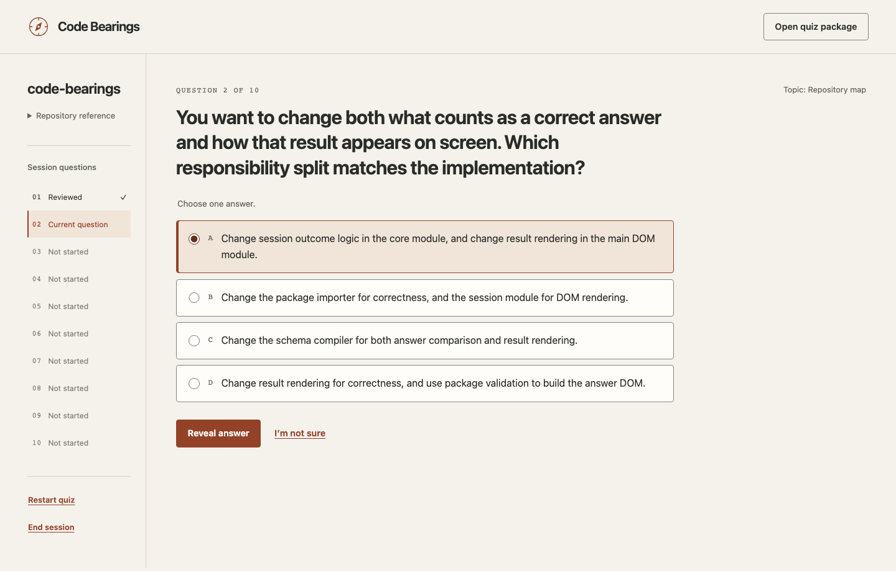
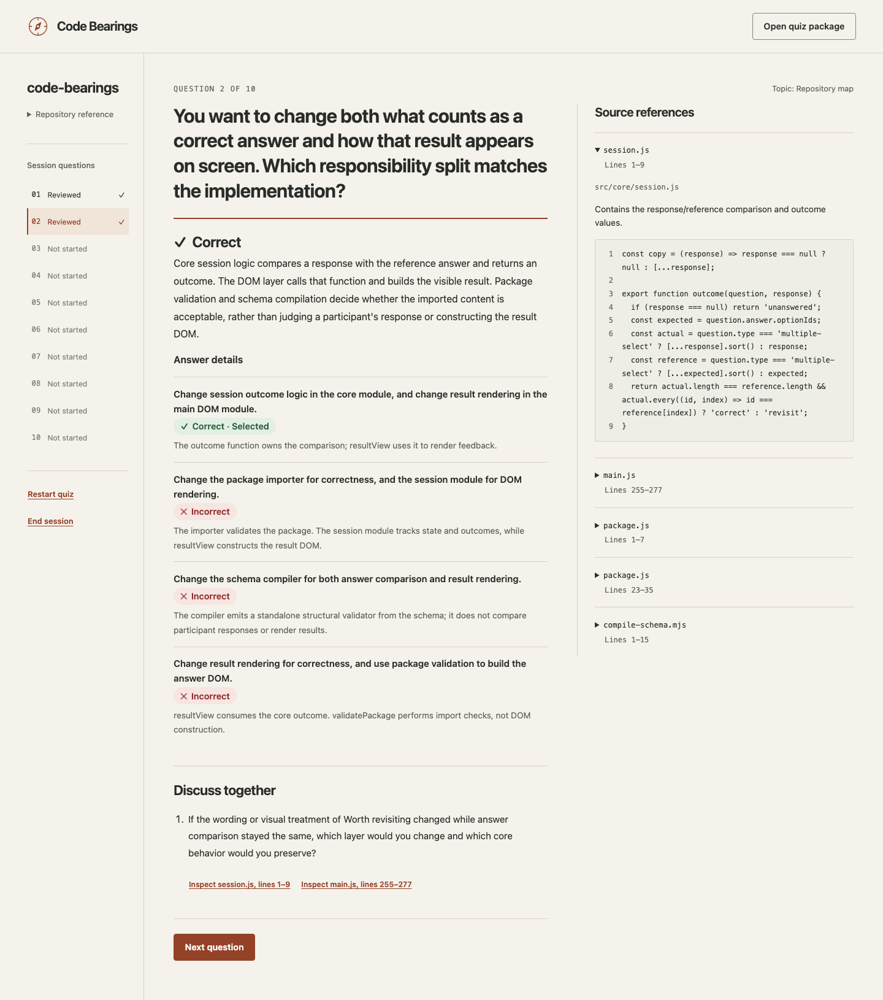

# Code Bearings

**Find your bearings in the code.**

When code is written faster than you can explore it, keeping a mental map of a repository gets harder. Code Bearings turns repository structure into short quizzes about responsibilities, dependencies, and execution flow. It’s designed for solo engineers and small teams working with AI-generated code.

Use it on your own or share a browser window in a team call. Answer a question, reveal the explanation and source evidence, then discuss how the code connects. Each quiz ends with a learning recap rather than an overall score.



<details>
<summary>See the revealed answer and source evidence</summary>



</details>

## Try the example

If you have a prepared viewer or skill archive, follow the [download instructions](docs/downloads.md) to use it without building from source. CI produces candidate archives; a tagged public release has not yet been published.

Requires **Node.js 22.12 or newer**, npm, and Git. These commands use POSIX shell syntax; setup has been exercised on macOS and in Ubuntu CI.

```bash
git clone https://github.com/michael-wr1/code-bearings.git
cd code-bearings
npm ci
npm run dev
```

1. Open **http://127.0.0.1:4173**.
2. Choose **Open quiz package** and select [examples/code-bearings.quiz.json](examples/code-bearings.quiz.json) from your checkout.
3. Select **Start quiz**. Choose an answer, or **I’m not sure**, then reveal it and explore the evidence.

The example is a newcomer overview of Code Bearings: **10 questions** across single-choice, multiple-select, and ordering, with a **25-minute target** including discussion. It was prepared from committed source and independently verified. Its source revision is pinned to [`db3133a`](https://github.com/michael-wr1/code-bearings/tree/db3133a9d148b06ba56845e7903a90c661c2f338) on `main`; filenames and line numbers refer to that snapshot, which may be older than your checkout. The target duration is a guide, not a measured completion time.

To inspect that exact source in another checkout:

```bash
git clone https://github.com/michael-wr1/code-bearings.git code-bearings-example
cd code-bearings-example
git checkout --detach db3133a9d148b06ba56845e7903a90c661c2f338
```

You can play a package without its original repository: source excerpts are embedded in the file. Answers and progress last until you refresh or close the page. After the viewer has loaded, playing an imported quiz needs no network connection. Optional external source links open when selected.

## Prepare a quiz for your repository

The viewer and preparation skill are free under the MIT license. Preparing new quizzes requires your own access to a coding agent, such as **Codex or Claude Code**, with independent subagent support. Generation and verification happen before play; the viewer needs no model-provider API keys.

From the Code Bearings checkout, build the portable skill:

```bash
npm run build:skill
```

Copy the **whole exported folder**, including its references, assets, tools, and license, into your agent’s skills directory. These commands are for a first installation; when updating, replace the existing skill folder with the new export.

For Codex:

```bash
mkdir -p ~/.agents/skills
cp -R .skill-build/code-bearings-quiz ~/.agents/skills/
```

For Claude Code:

```bash
mkdir -p ~/.claude/skills
cp -R .skill-build/code-bearings-quiz ~/.claude/skills/
```

Start a new coding-agent session **in the repository you want to learn**. Invoke `$code-bearings-quiz` in Codex or `/code-bearings-quiz` in Claude Code, then provide a request such as:

```text
Prepare a repository overview for newcomers using this branch’s committed tip.
Target 25 minutes including discussion. Save it to ~/quizzes/.
```

You can specify a branch, commit, familiarity level, duration, and destination. Missing familiarity and duration default to **new to the repo** and **25 minutes**. The agent asks for an output destination if you haven’t supplied one. Only committed code is used, and the package records the clone URL, branch, and full SHA.

To learn how a feature was built, ask for a change-set quiz instead:

```text
Prepare a change-set quiz about feature/import-history since it branched from main.
Save it to ~/quizzes/.
```

A change set can also be a merge commit or a squashed commit that has already landed. Questions focus on what the range introduced or modified and how it connects to existing code; excerpts come from the head commit, and the package records the base commit too. Change-set quizzes default to **already working in the repo**.

The agent creates the questions, asks a fresh verifier subagent to solve them from source before seeing the answer key, then has that verifier review the complete package. Preparation is incomplete if independent verification or required checks cannot run. The agent returns a `.quiz.json` file, with supporting preparation and review records in a separate `<name>.review/` folder. Open the `.quiz.json` file in the viewer; keep packages for private repositories and their supporting records in a private destination.

Once installed, the exported skill’s tools need **Node.js 22.12 or newer and Git**, with no npm dependencies or viewer checkout. See the [skill instructions](skills/code-bearings-quiz/SKILL.md), [preparation protocol](skills/code-bearings-quiz/references/preparation.md), and [package contract](skills/code-bearings-quiz/references/package-contract.md) for details.

## Tested environments and project status

Code Bearings is an **unsupported early preview** shared as a personal project. Use it at your own risk. Support, responses, fixes, and continued maintenance are not promised. Pull requests are not reviewed or accepted.

Bug reports are welcome through [GitHub Issues](https://github.com/michael-wr1/code-bearings/issues). Include reproduction steps, your browser and runtime versions, and a minimal fictional example if needed. Do not upload private quiz packages, source excerpts, credentials, or preparation reports.

- **Viewer:** Chromium through Playwright 1.58.2 on macOS and Ubuntu 24.04, including offline playback and keyboard ordering. A guided maintainer trial also exercised Firefox on macOS; its version was not recorded.
- **Preparation:** Codex CLI 0.162.1 and 0.166.0, and Claude Code 2.1.293 on macOS, using installed skills and actual independent verifier subagents.
- **Runtimes used for these checks:** Node.js 23.11.0 on macOS 27.0.1; Node.js 22.12.0 and 24.22.1 on Ubuntu 24.04 CI. Extracted viewer and skill archives are checked in CI as well.

Other environments have not yet been verified. Automated accessibility checks have passed; real screen-reader use and unassisted participant trials remain untested. The maintainer trial is not independent usability evidence. Session duration and learning effectiveness have not been measured. For automated Claude Code print-mode runs, leave session persistence enabled so the verifier can continue from blind solving to full review in a separate invocation.

## Build and check

For a production viewer:

```bash
npm run build
npm run preview
```

Open **http://127.0.0.1:4173**. The `dist/` directory contains static assets suitable for a local web server. The example stays separate from the viewer build; import it as a file.

Run the project checks:

```bash
npm test
npm run test:skill
npm run test:e2e
```

The browser suite uses pinned Playwright 1.58.2. If its matching Chromium is missing, install it with `npx playwright install chromium`. Browser tests use fictional fixtures; the public example has a separate source-based independent review.

To check a package from this checkout:

```bash
npm run validate-package -- examples/code-bearings.quiz.json
```

Import checks confirm package structure, references, and consistency with its recorded review and payload digest. They do not authenticate an agent identity or prove source correctness; those checks belong to preparation and independent source review. The [v1 schema](schema/quiz-package-v1.schema.json) and package contract describe the format. [AGENTS.md](AGENTS.md) provides repository guidance for coding agents.

Ordering questions now require at least three items. Earlier v1 packages with two-item ordering questions are rejected; their authors must revise and independently re-review them. Use single-choice questions for two-step relationships.

## License

Code Bearings, its preparation skill, and the included Code Bearings example are licensed under the [MIT License](LICENSE).

Viewer builds include `LICENSE` and `THIRD-PARTY-NOTICES.txt`. Skill exports include `LICENSE` and `assets/third-party-notices.txt`; retain these files when redistributing. Dependencies retain their own licenses. Packages you prepare for other repositories may contain source with different licenses; the Code Bearings license does not relicense that source.
